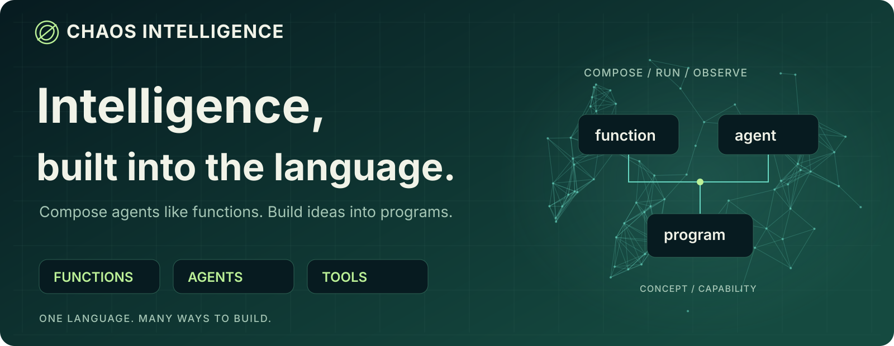
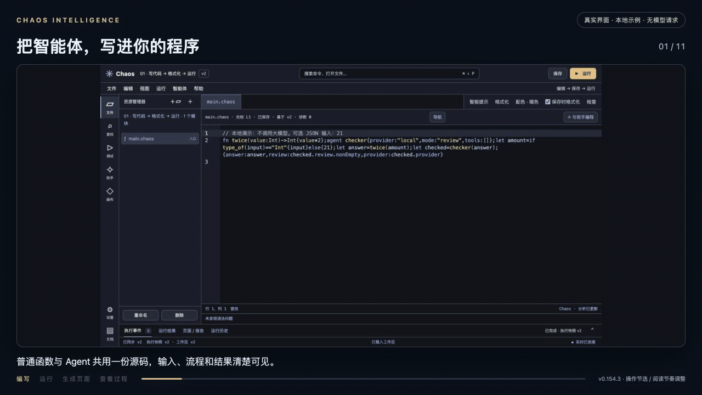
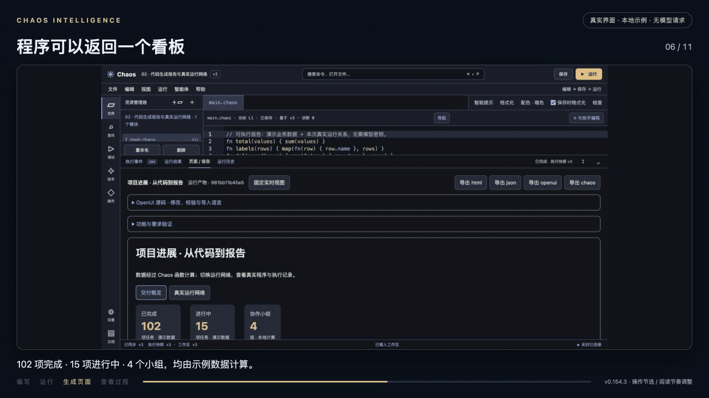

[简体中文](README.md) · **English**



<p align="center">
  <a href="https://github.com/Cattmonkey/ChaosIntelligence/releases/latest"><strong>Download</strong></a> ·
  <a href="#research-film">Watch the film</a> ·
  <a href="#start-in-your-own-directory">Quick start</a> ·
  <a href="docs/MODEL_EXAMPLES.md">Agent examples</a> ·
  <a href="docs/README.md">Documentation</a> ·
  <a href="https://github.com/Cattmonkey/ChaosIntelligence/issues">Feedback</a>
</p>

## Turn agents into functions. Turn ideas into programs.

**Chaos is a programming language that makes agents callable values—and a development environment you can bring into your project.** Compose ordinary functions with model-powered agents, coordinate work around a goal, and return an interactive page from the same program.

Use one `.chaos` source file through the native `chaos` CLI, the browser IDE, or the Python SDK. Keep exact computation in code and give models the parts that need interpretation or generation.

| Build | With Chaos |
| --- | --- |
| A reusable research or engineering workflow | Pass functions and agents as values; connect planning, execution, and review explicitly. |
| A Bot that works toward a goal | Combine plans, bounded work rounds, persistent state, and human guidance at checkpoints. |
| A report that explains its own data | Return UI components, tables, charts, or slides as program values. |
| An observable intelligent system | Follow public execution events and inspect project structure alongside recorded activity. |

<a id="research-film"></a>

## 3 minutes 34 seconds: Beyond the Curves


**A research team, expressed as a callable program.**

Five scientists and three engineers—all agents. A convincing fit leads them through independent validation, sensitivity to initial conditions, and a new experiment with a simplified neural excitability model. Hypotheses become function calls; evidence shapes the next question.

https://github.com/user-attachments/assets/b3def22d-53de-4867-9644-0367949d7a06

[Download the 1080p film](https://github.com/Cattmonkey/ChaosIntelligence/releases/download/v0.154.4/Chaos-Intelligence-Beyond-the-Curves-1080p.mp4) · [Reproduce the research](examples/research-lab/README.md) · [Cast, data, and production notes](docs/assets/research-film/README.md)

The fictional agents are dramatized; scientific figures come from actual numerical experiments. Chaos executes integration and error calculations, while NumPy/SciPy provide regression and independent references. [Experiments and model-call acceptance](docs/assets/research-film/README.md). Mandarin narration and captions.

<details>
<summary>Watch the existing 2-minute-35-second product introduction</summary>

The language, the IDE, and the systems you can compose with them. **Mandarin narration and captions.**

https://github.com/user-attachments/assets/2aa53c85-8d36-4e21-8322-2bdc9188f17a

[Download the 1080p film](https://github.com/Cattmonkey/ChaosIntelligence/releases/download/v0.154.4/Chaos-Intelligence-Brand-Film-1080p.mp4) · [Chinese subtitles](https://github.com/Cattmonkey/ChaosIntelligence/releases/download/v0.154.4/captions.zh-CN.srt)

The film combines actual product screens with labeled capability illustrations. Business figures in the reports are demonstration inputs.

</details>

## A small language example

Functions are values. Agents use the same call syntax.

```chaos
fn twice(f: Function, x) { f(f(x)) }
fn add_one(x: Int) -> Int { x + 1 }

twice(add_one, 40)
```

This returns `42`, without a model, an API key, or a network connection.

```chaos
agent teacher {
  provider: "model",
  role: "planner",
  prompt: "Explain the programming concept with one short example.",
  tools: [],
  maxSteps: 3
}

teacher("What is a closure?")
```

Configure a provider with `./chaos configure --models` or the project's `/control` page. The agent inherits the configured role; credentials stay out of source code. Declaring an agent does not call a model—the final expression does. Model requests may incur provider charges.

[Multi-role pipeline](examples/learning-models/pipeline.chaos) · [Concurrent analysis](examples/learning-models/parallel.chaos) · [Function tools](examples/learning-models/function-tools.chaos) · [Goal Bot](examples/learning-models/goal-bot.chaos)

## See the program work

### Write, format, run, inspect



The IDE brings file management, semantic colors, completion, signature help, formatting, and execution together. The programming assistant prepares changes for you to inspect and apply.

[Follow the walkthrough](examples/showcase/README.md) · [IDE guide](docs/IDE.md)

### Return a page. Observe a running system.



OpenUI components render program values. `RuntimeGraph` connects project structure with real run records; node details distinguish declared relationships from observed execution. Connected pages update as events arrive.

These walkthroughs use actual v0.154.3 screens, with captions and adjusted pauses for readability. Public events show work and results, not private model reasoning. Live updates require a connected host.

[Report source](examples/showcase/live-report.chaos) · [Generative UI](docs/GENERATIVE_UI.md) · [Runtime networks](docs/LIVE_NETWORK_UI.md)

## Start in your own directory

Download **`Chaos-Project.zip`** from the [latest release](https://github.com/Cattmonkey/ChaosIntelligence/releases/latest), extract it into a new directory, and open a terminal there. Choose the project package, rather than GitHub's automatically generated “Source code” archive.

**Requires Python 3.9+.** The current runtime uses Python; everyday programming uses Chaos commands. The package does not bundle Python or every optional dependency.

```sh
# Run the included program: 42
./chaos run

# Prepare the project environment, then open the IDE
./chaos setup --yes
./chaos
```

On Windows PowerShell, use `.\chaos.cmd` in place of `./chaos`. Setup installs project dependencies, runs self-checks, and saves configuration; it needs access to a Python package source. Open the actual address printed by the launcher.

Prefer the terminal? Use `./chaos -c '40 + 2'` or `./chaos repl --empty`. An installed CLI uses `chaos`; the source checkout uses `./bin/chaos`. Explicit Python entry points remain available when needed.

[Installation](docs/INSTALLATION.md) · [Getting started](docs/GETTING_STARTED.md) · [Command line](docs/COMMAND_LINE.md)

## Compose more than a chat

| Capability | Explore |
| --- | --- |
| Functions, closures, modules, macros, generators, and async tasks | [Language reference](docs/LANGUAGE.md) · [Language contract](docs/LANGUAGE_CONTRACT.md) |
| Goals, persistent work, and user guidance at receiving checkpoints | [Native Bots](docs/NATIVE_BOTS.md) · [Real-time interaction](docs/REALTIME.md) |
| Model configuration and reusable agent workflows | [Model setup](docs/MODEL_CONFIGURATION.md) · [Five model examples](docs/MODEL_EXAMPLES.md) |
| Tools, computers, mobile devices, robots, and HID adapters | [Function tools](docs/FUNCTION_TOOLS.md) · [Devices](docs/ROBOT_DEVICES.md) |
| Supported numerical workloads on CPU, CUDA, or Apple M-series MPS | [GPU computing](docs/GPU_COMPUTE.md) · [Metal](docs/GPU_METAL.md) |
| Integration with existing applications | [Python SDK](docs/SDK.md) · [HTTP API](docs/HTTP_API.md) |

Device and GPU features depend on the relevant hardware, dependencies, configuration, and permissions. Current physical-machine acceptance is based on macOS with Python 3.9/3.13; platform launchers do not imply that every feature has been tested on every operating system.

Chaos has its own language semantics and documented computational core. Complete Python/Lisp compatibility, general-purpose machine-code AOT, and an independent garbage collector are not claimed. See the [language contract](docs/LANGUAGE_CONTRACT.md) for supported behavior and boundaries.

## Learn, build, and contribute

Most tutorials, reference pages, and walkthrough captions are currently **in Chinese**. This English introduction covers the starting path; the linked source examples are the next step.

- **Try a workflow:** run an [example](examples/showcase/README.md) and share what helped or got in your way.
- **Build an integration:** start with the [SDK](docs/SDK.md) and [developer guide](docs/DEVELOPER.md).
- **Improve the project:** report reproducible issues, contribute fixes, or help make the documentation accessible to more developers.
- **Keep your own work:** use the documented [replace and rollback workflow](docs/UPDATES.md) when upgrading an existing project.

[Browse documentation](docs/README.md) · [Open an issue](https://github.com/Cattmonkey/ChaosIntelligence/issues) · [Support the project](README.md#支持项目)

## License

Original material is **source-available** under the [Chaos No-AI-Training License 1.0](LICENSE). It permits ordinary use, modification, redistribution, and commercial use subject to its terms, while restricting use of covered material for AI/model training without separate permission. This is **not an OSI-approved open-source license**.

Normal inference and coding assistance are permitted under the license's conditions. Third-party components retain their own licenses; see [third-party notices](THIRD_PARTY_NOTICES.md). The repository license does not override separate platform agreements. [License guide](docs/LICENSING.md)
