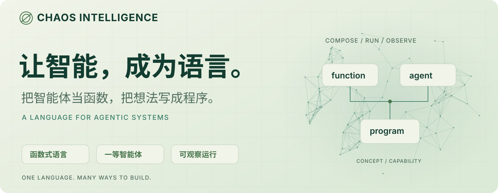
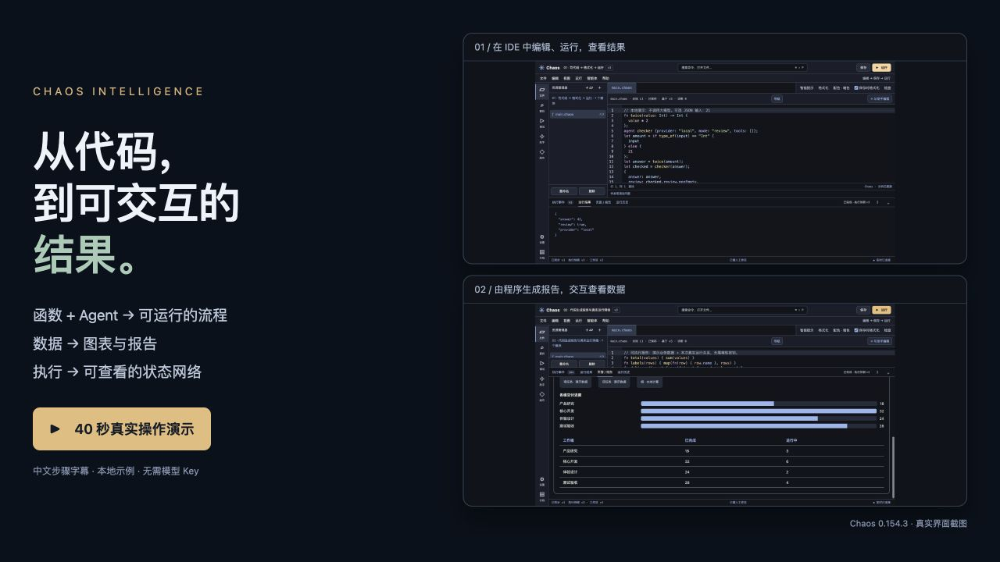

# Chaos Intelligence

<p align="right"><strong>简体中文</strong> · <a href="README.en.md">English</a></p>

<picture>
  <source media="(max-width: 700px) and (prefers-color-scheme: dark)" srcset="docs/assets/brand/hero-mobile-dark.svg">
  <source media="(max-width: 700px)" srcset="docs/assets/brand/hero-mobile-light.svg">
  <source media="(prefers-color-scheme: dark)" srcset="docs/assets/brand/hero-dark.svg">
  <source media="(prefers-color-scheme: light)" srcset="docs/assets/brand/hero-light.svg">
  
</picture>

<p align="center">
  <a href="https://github.com/Cattmonkey/ChaosIntelligence/releases/latest"><strong>下载使用包</strong></a> ·
  <a href="#2-分-35-秒认识-chaos-intelligence"><strong>观看宣传片</strong></a> ·
  <a href="docs/GETTING_STARTED.md"><strong>十分钟开始</strong></a> ·
  <a href="docs/README.md"><strong>文档中心</strong></a> ·
  <a href="#支持项目"><strong>支持项目</strong></a>
</p>

## 把智能体当函数，把想法写成程序。

**Chaos 是一门以函数为基础、把智能体作为可调用值的编程语言。** 计算与流程写成函数，理解与生成交给智能体；让它们在同一个程序里传递数据、协作执行、返回结果。

一份 `.chaos` 源码，从终端到网页 IDE，再到已有工程。你可以从一个小函数开始，逐步构建有目标、能交互、可观察的智能系统。

## 2 分 35 秒，认识 Chaos Intelligence

**让智能，成为语言。** 从能调用的智能体，到围绕目标工作的 Bot，再到可交互的报告与运行网络。

https://github.com/user-attachments/assets/2aa53c85-8d36-4e21-8322-2bdc9188f17a

[下载 1080p 原片](https://github.com/Cattmonkey/ChaosIntelligence/releases/download/v0.154.4/Chaos-Intelligence-Brand-Film-1080p.mp4) · [中文字幕](https://github.com/Cattmonkey/ChaosIntelligence/releases/download/v0.154.4/captions.zh-CN.srt) · [宣传封面与素材说明](docs/assets/brand-film/README.md)

中文配音、原创配乐与真实界面。角色协作和设备连接使用标注的能力示意；报告数字为演示输入，设备与 GPU 按配置、授权和支持范围启用。

### 用它做什么？

| 你想实现的系统 | 用 Chaos 怎样构建 |
| --- | --- |
| **组合智能工作流** | 将规划、执行与复核接成程序；用函数处理精确计算，用模型处理理解与生成。[多角色示例 →](examples/learning-models/pipeline.chaos) |
| **围绕目标持续工作的 Bot** | 将目标、上下文与验收写进流程，通过持久状态延续工作，在接收点追加指导。[目标 Bot →](examples/learning-models/goal-bot.chaos) |
| **可交互的页面与报告** | 用程序生成页面、表格、图表与演示，把计算结果变成可查看的交付物。[页面与报告 →](docs/GENERATIVE_UI.md) |
| **看得见运行过程的系统** | 查看事件流、关系网络与节点详情，追踪执行结果和用户指导是否被采用。[实时交互 →](docs/REALTIME.md) |

这些能力共享语言、项目配置与工具权限。换模型、增加角色、接入设备，继续组合已有函数和模块。[语言设计与支持范围 →](docs/LANGUAGE_CONTRACT.md)

## 先看看它怎样工作

**40 秒，从代码到看得见的结果。** 编辑 → 运行 → 生成看板 → 查看运行网络。

[](https://raw.githubusercontent.com/Cattmonkey/ChaosIntelligence/main/docs/assets/showcase/overview.mp4)

[▶ 播放／下载操作演示](https://raw.githubusercontent.com/Cattmonkey/ChaosIntelligence/main/docs/assets/showcase/overview.mp4) · [按步骤复现](examples/showcase/README.md)

`00:00` 编写与排版 · `00:08` 运行与事件 · `00:15` 图表与排序 · `00:26` 网络与节点详情

### 写代码 → 格式化 → 运行 → 看结果


文件、代码、运行结果，一处完成。语义配色、名称补全、参数提示和保存时格式化使用同一语言分析服务；“与助手编程”可以生成可检查、可应用的修改提案。

[IDE 使用指南](docs/IDE.md) · [跟着动图操作](examples/showcase/README.md) · [静态截图](docs/assets/showcase/ide-workflow.png)

### 让程序展示自己的数据与运行状态


页面和报告是程序返回的值。OpenUI 组件负责展示，`RuntimeGraph` 读取项目结构与实际运行记录，节点详情区分声明关系与实际观测，页面随收到的运行事件更新。

[运行同款报告](examples/showcase/live-report.chaos) · [实时网络页面](docs/LIVE_NETWORK_UI.md) · [静态截图](docs/assets/showcase/live-dashboard.png)

<details>
<summary>演示来源与数据说明</summary>

操作视频与动图来自 v0.154.3 已验收的真实界面，添加步骤字幕并调整停顿以便阅读。示例无需模型 Key；报告数字是演示输入，网络读取项目结构与实际运行记录。模型生成内容需另行配置；公开执行事件不包含模型内部推理。

</details>

## 三个小例子，看懂这门语言

### 1. 普通计算，先从 42 开始

```chaos
fn twice(f: Function, x) { f(f(x)) }
fn add_one(x: Int) -> Int { x + 1 }

twice(add_one, 40)
```

结果是 `42`。函数可以作为参数，最后一个表达式就是程序结果。保存为 `hello.chaos`，执行 `./chaos run hello.chaos`。**纯计算无需网络与模型密钥。** [函数组合 →](docs/FUNCTION_COMPOSITION.md)

### 2. 调用智能体，就像调用函数

```chaos
agent teacher {
  provider: "model",
  role: "planner",
  prompt: "用一个短例子解释输入中的编程概念。",
  tools: [],
  maxSteps: 3
}

teacher("闭包是什么？")
```

在项目 `/control` 或 `./chaos configure --models` 中保存自己的模型配置，角色继承相应设置，密钥留在源码之外。声明不会请求模型，最后一行调用才执行；本例不授予工具权限，真实调用可能产生供应商费用。[配置模型 →](docs/MODEL_CONFIGURATION.md)

从这里继续组合：[规划 → 写作 → 复核](examples/learning-models/pipeline.chaos) · [并发分析](examples/learning-models/parallel.chaos) · [函数计算，模型解释](examples/learning-models/function-tools.chaos) · [目标 Bot](examples/learning-models/goal-bot.chaos)。完整步骤见[五个大模型示例教程](docs/MODEL_EXAMPLES.md)。

### 3. 程序可以返回一个实时页面

```chaos
ui_artifact("page", "系统实时网络",
  ui_node("RuntimeGraph", [
    "真实运行状态", "radial", "project", "auto"
  ])
)
```

在 IDE 保存为入口并运行，在“页面 / 报告”中查看项目网络。它可以从函数返回、由智能体生成，也可以嵌入更大的报告；实时数据由在线宿主提供，离线导出明确显示未连接。

[完整网络源码](examples/live-network.chaos) · [表格报告](examples/ui-report.chaos) · [自动翻页演示](examples/ui-slides.chaos)

## 三步开始，在自己的目录里用

需要 **Python 3.9+**；日常编程使用语言自己的命令。macOS／Linux 使用 `./chaos`，Windows PowerShell 使用 `.\chaos.cmd`。

1. 从[最新发行版](https://github.com/Cattmonkey/ChaosIntelligence/releases/latest)下载 **`Chaos-Project.zip`**，解压到新目录并打开终端。
2. 执行 `./chaos run`，运行自带程序，确认得到 `42`。
3. 执行以下命令，配置环境并打开当前目录的 IDE：

   ```sh
   ./chaos setup --yes
   ./chaos
   ```

`setup` 检测环境、安装项目内依赖并运行自检；按终端打印的实际地址进入网页。包不包含 Python，首次完整配置需要可访问的 Python 包来源。[快速开始 →](docs/GETTING_STARTED.md)

### 喜欢终端？可以全程不用网页

```sh
./chaos -c '40 + 2'
./chaos run main.chaos
./chaos repl --empty
./chaos ask '给我一个函数组合的短例子' --topic getting-started --stream
```

`ask` 需要配置模型，流式回答且不修改文件；IDE 助手或 `assist` 可生成代码修改提案。[命令行教程 →](docs/COMMAND_LINE.md)

<details>
<summary>已有工程、源码开发与兼容入口</summary>

从使用包运行 `./chaos install "/absolute/path/my-project"` 可安装到已有工程，冲突时保留原内容。只需语言核心可用 `setup --yes --profile core`。GitHub 自动生成的 “Source code” 归档用于源码开发，不是上述使用包。

已安装 CLI 使用 `chaos`；源码仓库使用 `./bin/chaos`，执行 `export PATH="$PWD/bin:$PATH"` 后，当前终端也可使用 `chaos`。需要显式选解释器时，目录包支持 `python3 chaos.py`，源码支持 `python3 -m chaos`。[安装与兼容入口](docs/INSTALLATION.md) · [源码开发与测试](docs/DEVELOPER.md)

</details>

## 从小程序到更复杂的系统

| 能力 | 组合方向 | 参考 |
| --- | --- | --- |
| 语言核心 | 函数、闭包、模块、模式、宏、生成器与异步任务 | [语言参考](docs/LANGUAGE.md) · [标准库](docs/STDLIB.md) |
| 长期目标 | Bot 组合计划、执行与验收；Session／Process 持久化工作状态 | [原生 Bot](docs/NATIVE_BOTS.md) · [持久示例](examples/durable-bot/main.chaos) |
| 交互与引导 | 订阅公开事件、在接收点追加指导、显式停止 | [实时交互](docs/REALTIME.md) |
| 工具与设备 | 函数工具、电脑、手机与机器人能力 | [函数工具](docs/FUNCTION_TOOLS.md) · [电脑](docs/COMPUTERS.md) · [手机](docs/MOBILE_COMPUTERS.md) · [HID](docs/ROBOT_DEVICES.md) |
| GPU 计算 | 支持范围内的函数使用 CPU／CUDA／Apple M 系列 MPS，MPS 可选融合 Metal 内核 | [GPU](docs/GPU_COMPUTE.md) · [Metal](docs/GPU_METAL.md) · [控制流范围](docs/GPU_CONTROL_FLOW.md) |
| 工程嵌入 | SDK 与 HTTP 接口共享语言及服务事件 | [Python SDK](docs/SDK.md) · [HTTP API](docs/HTTP_API.md) |

工具、设备与 GPU 需要相应依赖、硬件和授权。当前实机验收以 macOS、Python 3.9／3.13 为基础；Windows／Linux 的入口适配不代表所有功能均已完成实机验收。抽象计算核心的图灵完备论证与工程范围见[语言契约](docs/LANGUAGE_CONTRACT.md)。

## 更新时保留自己的程序

<details>
<summary>完整包替换、校验与回退</summary>

取得新版完整 project ZIP 或 portable ZIP，停止本项目的 IDE 与程序，在原工程执行：

```sh
./chaos replace "/absolute/path/Chaos-Project-New.zip"
./chaos status
```

更新先校验与试运行，再切换环境，保留项目源码、配置与数据；`./chaos rollback` 可恢复上一环境及配套依赖。若 `dependenciesReady` 为 `false`，按提示运行 `./chaos setup --yes`。不要把新版 ZIP 直接覆盖解压到旧工程。[更新与回退 →](docs/UPDATES.md)

</details>

## 按你的目标继续学习

| 我想…… | 从这里开始 |
| --- | --- |
| 运行第一个程序 | [快速开始](docs/GETTING_STARTED.md) · [用户指南](docs/USER_GUIDE.md) · [IDE](docs/IDE.md) |
| 使用真实模型 | [模型配置](docs/MODEL_CONFIGURATION.md) · [五个大模型示例](docs/MODEL_EXAMPLES.md) |
| 学习语言与智能体 | [语言参考](docs/LANGUAGE.md) · [智能体函数](docs/AGENT_LANGUAGE.md) · [语言契约](docs/LANGUAGE_CONTRACT.md) |
| 生成报告与可视化 | [生成式 UI](docs/GENERATIVE_UI.md) · [实时网络](docs/LIVE_NETWORK_UI.md) |
| 让系统基于经验改进 | [Harness 持续改进](docs/HARNESS_EVOLUTION.md) · [源码与状态演进](docs/PROCESS_EVOLUTION.md) |
| 扩展、嵌入与发布 | [开发者指南](docs/DEVELOPER.md) · [SDK](docs/SDK.md) · [发布指南](docs/RELEASING.md) |
| 排查问题 | [环境配置](docs/DEPLOYMENT.md) · [故障排查](docs/TROUBLESHOOTING.md) |

更多专题见[文档中心](docs/README.md)。欢迎通过 [Issues](https://github.com/Cattmonkey/ChaosIntelligence/issues)反馈问题、提出用例与参与改进；给项目一个 Star，帮助更多开发者发现它。

## 许可：源码可见，禁止用于 AI／大模型训练

原创源码、文档与示例采用 **Chaos No-AI-Training License 1.0**，允许学习、运行、修改、分发和商业使用；未经另行书面许可，不得用于模型训练或训练数据集。正常推理、AI 编程辅助及处理用户自己的数据不因此被禁止。

完整约束以 [LICENSE](LICENSE) 为准；第三方组件保留各自许可，见 [THIRD_PARTY_NOTICES.md](THIRD_PARTY_NOTICES.md)。本项目是带用途限制的源码可见许可，不是 OSI 定义的开源许可；许可不是技术防抓取措施，也不能撤销另行授予托管平台的权利。[许可指南](docs/LICENSING.md)

## 支持项目

如果 Chaos Intelligence 对你有帮助，欢迎自愿赞赏，支持持续开发、文档完善与维护。赞赏不影响使用权限，也不改变[项目许可](LICENSE)。

| 微信 | 支付宝 |
| --- | --- |
| <a href="docs/assets/support/wechat.jpg"></a> | <a href="docs/assets/support/alipay.jpg"></a> |

点击图片可查看原图，用对应应用扫码即可自愿赞赏。感谢每一位使用、反馈问题、贡献代码或支持项目的朋友。
