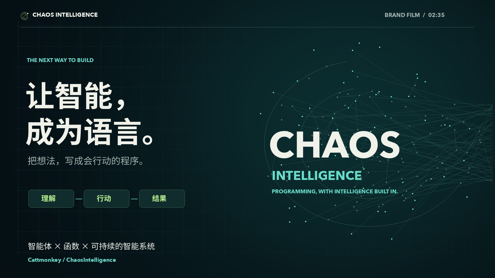

# Chaos Intelligence 宣传片

把智能体当函数，把想法写成程序。

[在线播放（仓库首页原生播放器）](https://github.com/Cattmonkey/ChaosIntelligence#2-分-35-秒认识-chaos-intelligence) · [下载 1080p MP4](https://github.com/Cattmonkey/ChaosIntelligence/releases/download/v0.154.4/Chaos-Intelligence-Brand-Film-1080p.mp4) · [中文字幕 SRT](https://github.com/Cattmonkey/ChaosIntelligence/releases/download/v0.154.4/captions.zh-CN.srt)

全片约 2 分 35 秒，中文旁白、原创程序化配乐。原片为 1920×1080、30 fps、H.264 + AAC；首页使用 1280×720 压缩版本，便于在线播放。

## 素材与表达

真实 IDE、报告和运行网络画面来自 v0.154.3 已验收的演示工作区，经过选帧、镜头运动和字幕排版。报告业务数字为演示输入，网络读取项目结构与执行记录；它们不代表客户业绩或同时运行的智能体数量。公开事件不等于模型内部推理。

角色协作、长期目标轨迹和设备连接采用标注的能力示意。模型、工具、设备与 GPU 需要相应配置、依赖、授权和硬件，具体范围以项目文档为准。

旁白使用百度语音合成的预置音色，未进行声纹克隆。配乐由合成波形与节奏编排生成，没有采样现有歌曲。账户密钥、私人模型地址及临时令牌均不属于发布素材。

本次仅增加宣传材料，没有更改 v0.154.4 的软件包、源码归档或既有校验文件。项目原创材料的使用以仓库 LICENSE 为准。
